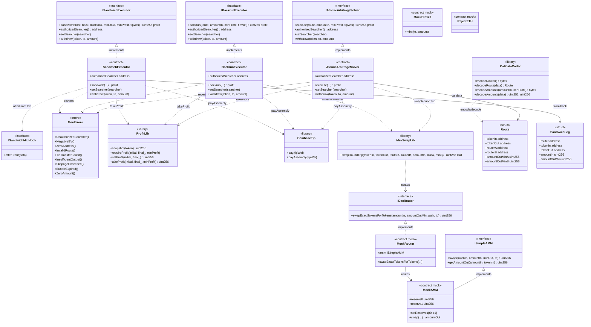

# Class Diagram — MEV & HFT Trading Infrastructure

Structural view of contracts, libraries, and interfaces (module 15, **v1 implemented**).

## Diagram (Mermaid)

## Key relationships

| Relationship | Reason |
|--------------|--------|
| Solver/Backrun → `MevSwapLib` | Gas-optimized 2-router round-trip |
| Solver/Executors → `ProfitLib.takeProfit` | Snapshot + `minProfit` in a single pass |
| Solver/Executors → `CoinbaseTip.payAssembly` | Yul tip to `block.coinbase` |
| Sandwich → `ISandwichMidHook` | Simulated victim in the lab (same tx) |
| `CalldataCodec` → `Route` | Packed 144 B for off-chain builders |
| AMM/Router/`RejectETH` mocks | Pool imbalance + failed tip in tests |

## Design decisions (v1)

- Three separate executors (arb / backrun / sandwich) to isolate attack surface and tests.
- `Ownable2Step` + `authorizedSearcher` per contract.
- Tip **inside** the same tx: if `takeProfit` fails, the tip is reverted too.
- Sandwich is **lab/fork only** via midHook; no mainnet runbook.
- No `forceApprove(0)` after swaps (gas tradeoff; trusted routers) — see [`GAS-EN.md`](./GAS-EN.md).
- Flashbots bundles are off-chain (`SimulateBundle.s.sol`); on-chain only executes.
- Next.js frontend: post-v1.
