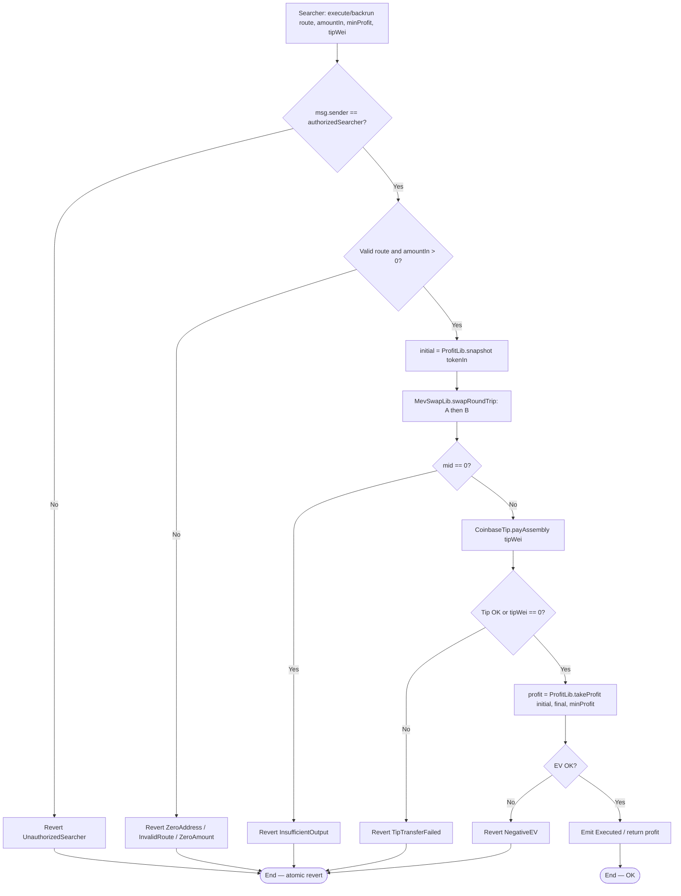
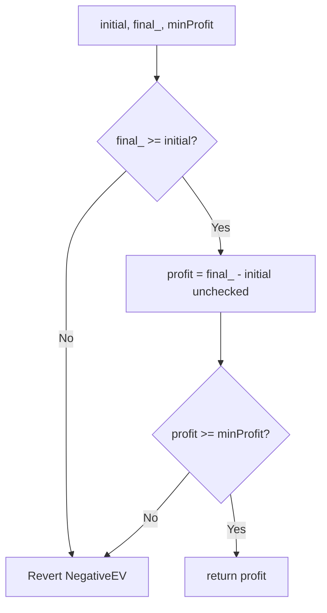
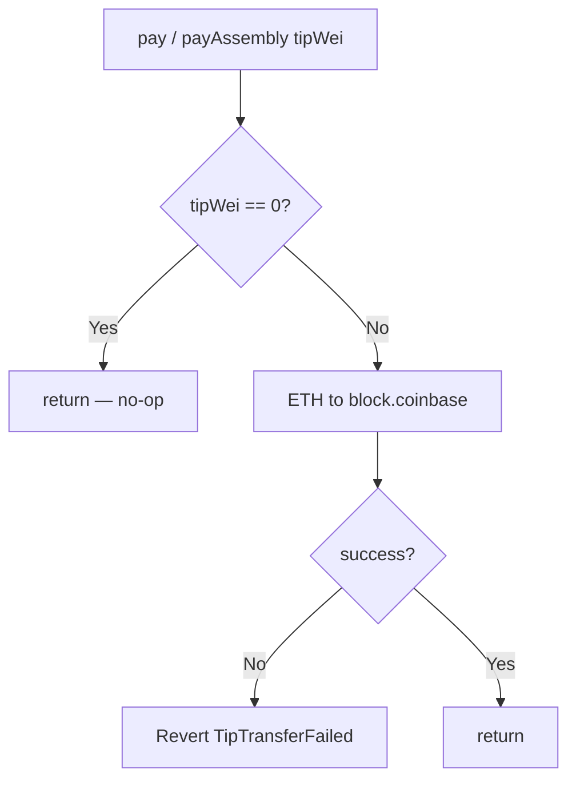
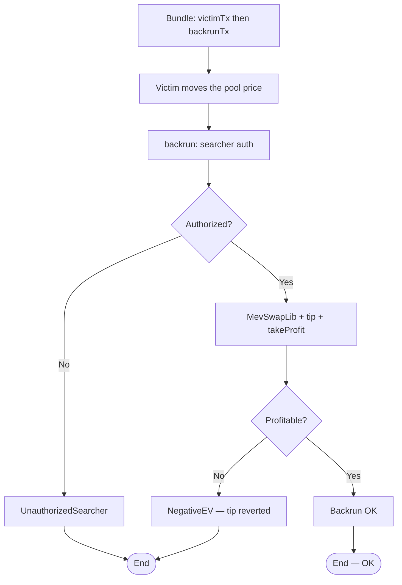
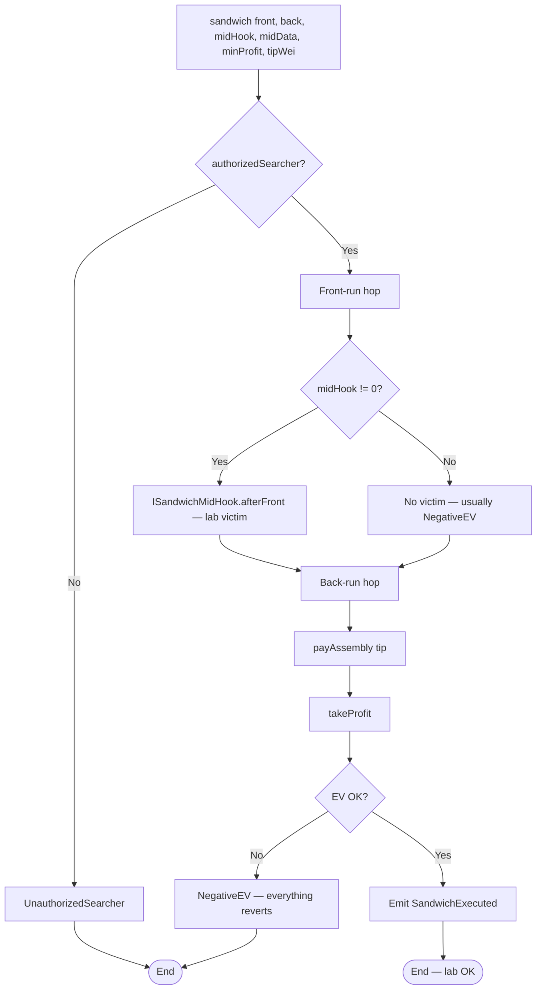
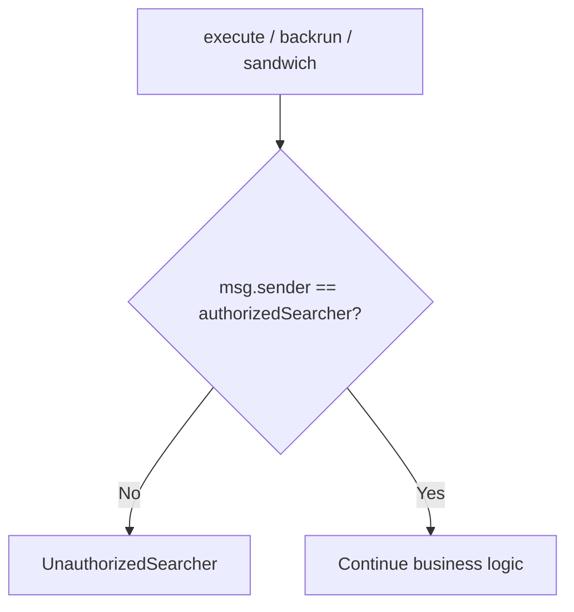
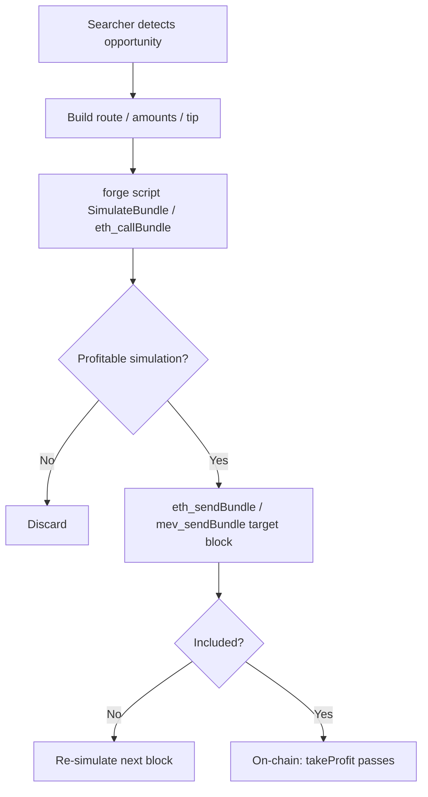
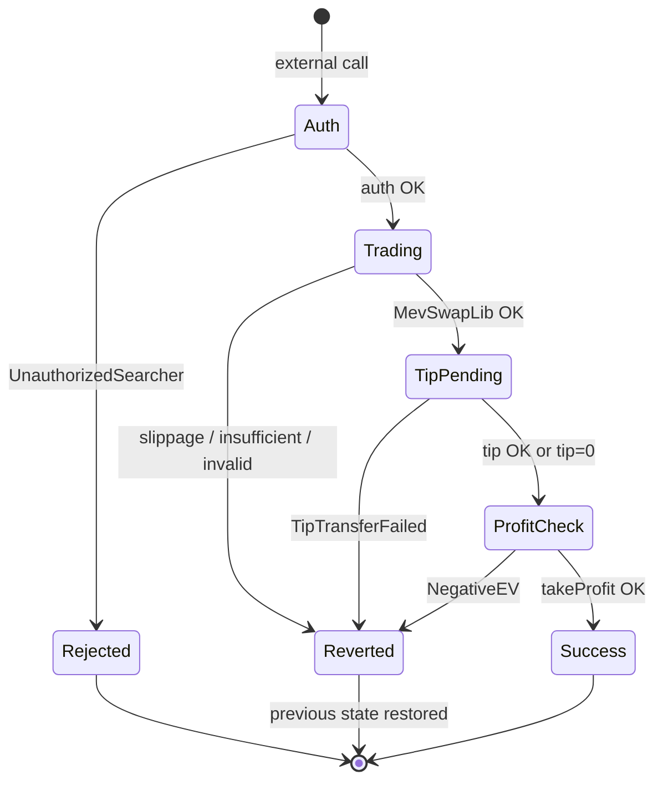
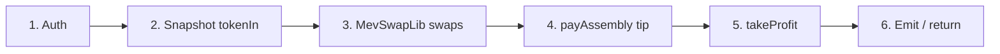

# Flow Diagram — MEV Solvers, Tips, and Profit Checks

Internal decision flows of the atomic executors (module 15, **v1 implemented**).

## 1. AtomicArbitrageSolver.execute / BackrunExecutor.backrun

> Atomicity: any revert undoes the swaps **and** the tip (no residual bribe).  
> Per-hop slippage: enforced by the router/AMM (`MockAMM.SlippageExceeded`).

## 2. ProfitLib.takeProfit

## 3. CoinbaseTip — payment to the builder

> Production: `payAssembly` (Yul). Tests compare it against `pay` (`.call`) — see [`GAS-EN.md`](./GAS-EN.md).

## 4. Post-victim backrun (bundle / test)

## 5. SandwichExecutor.sandwich (lab)

## 6. Cross-cutting access guard

## 7. Bundle simulation (off-chain)

## 8. State cycle — atomic tx

## 9. Order of effects (hot path)

