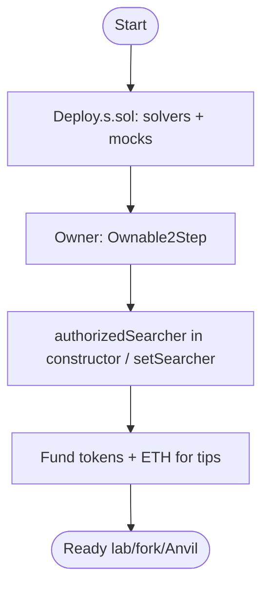
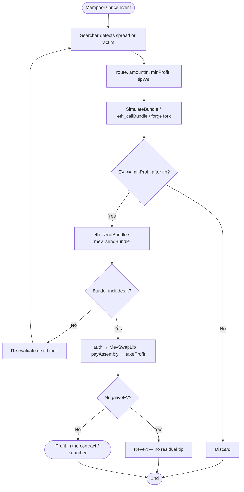
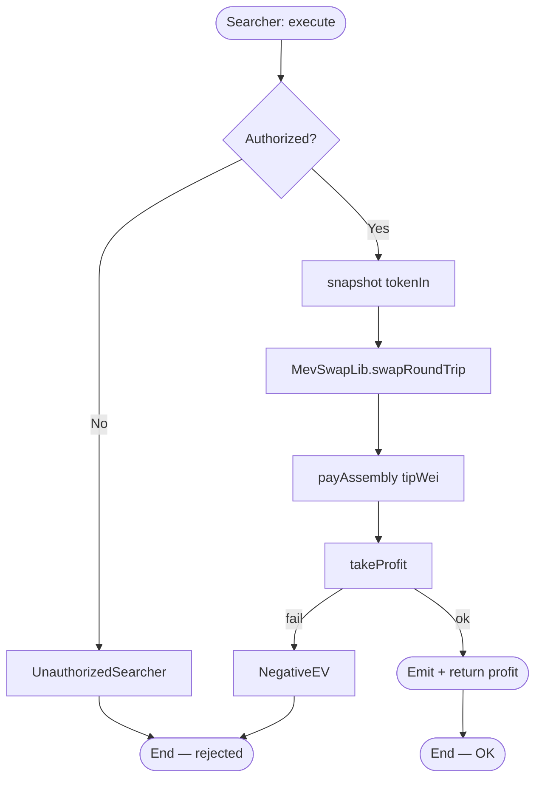
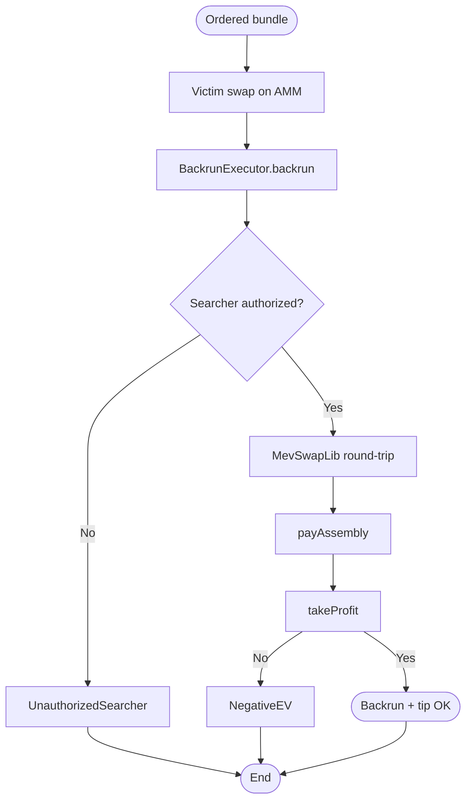
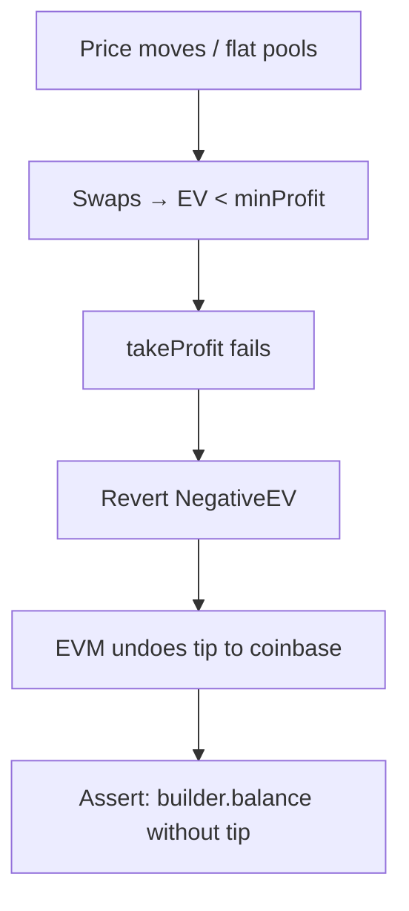
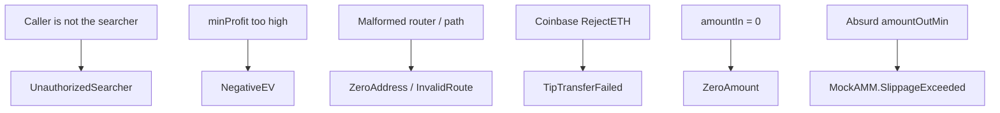
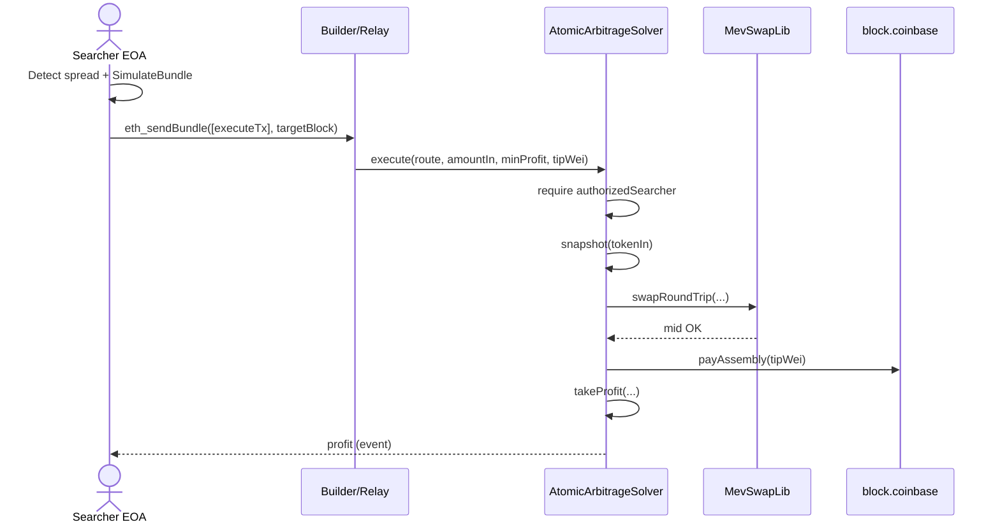
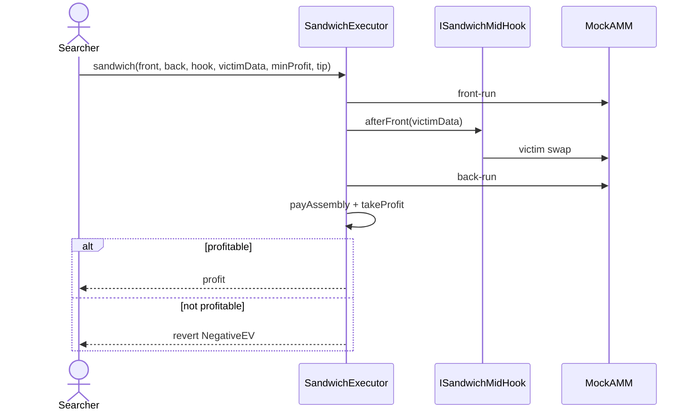
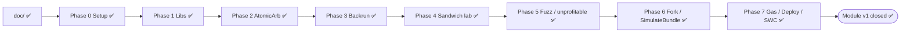

# Flowchart — Full MEV & HFT Infrastructure Cycle

End-to-end flow between actors, contracts, and relay/builder (module 15, **v1 implemented**).

## Actors

| Actor | Role |
|-------|------|
| Searcher EOA | Detects opportunities; signs and sends the bundle txs |
| AtomicArbitrageSolver | 2-router arb + `MevSwapLib` + tip + `takeProfit` |
| BackrunExecutor | Captures post-victim spread (same hot path) |
| SandwichExecutor | Front → midHook victim → back (lab/fork) |
| MevSwapLib / ProfitLib / CoinbaseTip | Swap, EV, and tip libraries |
| DEX / AMM (mocks) | Pools where the imbalance happens |
| Builder / Flashbots Relay | Private bundle; tip via `block.coinbase` |
| CI / Foundry | Unit, fuzz, fork, gas, `SimulateBundle` |

---

## Main flowchart — Deploy + authorization

---

## Main flowchart — Searcher → bundle → on-chain

---

## Main flowchart — Atomic arbitrage

---

## Main flowchart — Backrun after victim

---

## Flowchart — Revert-on-unprofitable (no bribe)

---

## Flowchart — Typical attacks / misuse

---

## Sequence — arbitrage happy path + tip

---

## Sequence — sandwich lab (midHook)

---

## Implementation governance

**Gate:** do not move to the next phase without *"I authorize Phase N"*. Details in [`planificacion-EN.md`](./planificacion-EN.md).  
**Status:** Phases **0–7** ✅ (module v1 closed).
